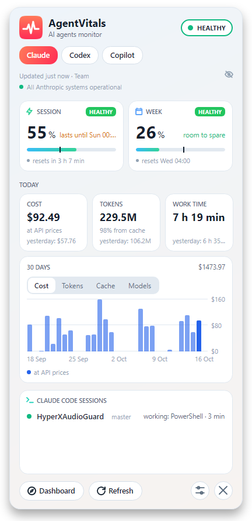
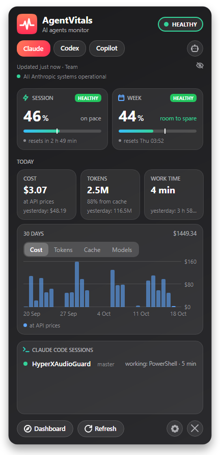
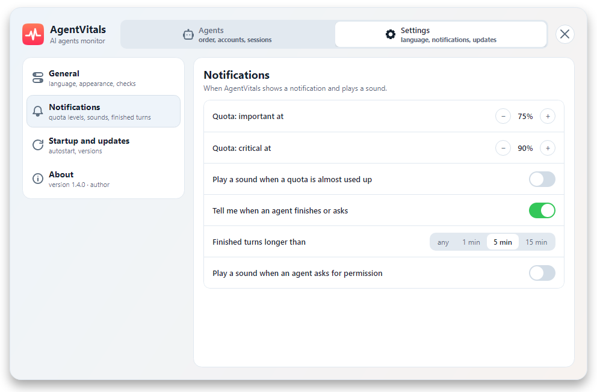
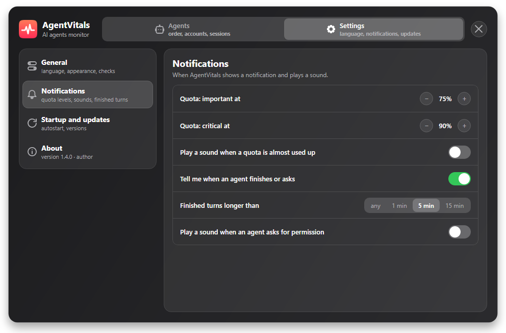

#  AgentVitals

**Claude Code quotas, live sessions and spend — in the Windows tray.**

A Windows tray app that shows how much of your Claude quota is left and when it resets, what each
Claude Code or Codex session is doing right now, what today's work would cost at API prices, and whether
the agent's service is up. A toast warns you before you run out, when Claude finishes a long turn and when it
asks for permission. Inspired by [ClaudeBar](https://github.com/tddworks/ClaudeBar) and
[claude-status-bar](https://github.com/m1ckc3s/claude-status-bar), which do this on macOS.

| Light | Dark |
|---|---|
|  |  |

## Quick start

1. Download `AgentVitals.exe` from the [latest release](https://github.com/CrossWander/AgentVitals/releases/latest).
   It needs the [.NET 10 Runtime](https://dotnet.microsoft.com/download/dotnet/10.0). There is no
   installer: the exe runs from any folder.
2. Start it. A pulse icon appears in the tray. Windows 10 may put it into the hidden area — drag it
   onto the taskbar once.
3. If you are signed in to Claude Code, the quotas show up right away. To see live sessions, open
   Settings → *Live sessions* → **Connect**.

Hover the icon for a quick card, click it for the full window, right-click for the menu. The window
stays open while you work in other windows: close it with ✕, another click on the icon or Esc.
On a small screen it stays within the screen: the header and the buttons stay put and the middle
scrolls.

## What it covers

| Area | What you get |
|---|---|
| Quotas | Session, week and per-model weekly limits with a reset countdown; a mark on the bar shows where even spending would be by now → [more](#quotas-and-alerts) |
| Tray icon | A pulse line coloured by the limit closest to running out; it beats while Claude works, and a blue dot blinks while Claude waits for you |
| Alerts | Toasts at 75% and 90% of a limit (adjustable from 50% to 95%), when a limit won't last until its reset at this pace, when a critical limit resets, when a long turn ends, when Claude asks for permission and when an agent's service status changes; two soft sounds you can turn on — for permission and for *critical* |
| Live sessions | Every open Claude Code and Codex session, on its agent's tab, with its folder, git branch, state and turn timer → [more](#live-sessions) |
| Usage statistics | Today's cost, tokens and working time next to yesterday's; a 30-day chart of cost, tokens, cache or models → [more](#usage-statistics) |
| Service status | Each tab shows its agent's: status.claude.com for Claude, the Codex group of status.openai.com for Codex (the whole OpenAI page only if that group disappears); a toast when one changes |
| After sleep | Asks again as soon as the PC wakes; a window whose reset time has passed shows 0% instead of stale numbers |
| Updates | Checks GitHub at start and once a day and toasts a new version once; **Update** in settings downloads it, checks its SHA-256 and swaps the exe in place → [more](#updates) |
| Screen sharing | The eye at the end of the plan line hides the account email and session prompts, in the window and the hover card |
| Languages and themes | English, Ukrainian and Russian; light, dark or as in Windows |
| Keyboard | Esc closes the window, F5 or Ctrl+R refreshes, Ctrl+1, Ctrl+2… switch the agent tabs in their order |

## Settings

The sliders button at the bottom of the window, or *Settings* in the right-click menu, opens
settings: language, theme, how often to check quotas, the *important* and *critical* levels,
session toasts, their two sounds, start with Windows and the Claude Code hooks for live sessions.

| Light | Dark |
|---|---|
|  |  |

## Providers

| Provider | Source | Status |
|---|---|---|
| Claude | `GET api.anthropic.com/api/oauth/usage` with the Claude Code token from `~/.claude/.credentials.json` | working |
| Codex | `GET chatgpt.com/backend-api/wham/usage` with `~/.codex/auth.json`; the account email from its `id_token` | working |
| Gemini | `cloudcode-pa.googleapis.com` quota calls with `~/.gemini/oauth_creds.json` | not verified |
| Copilot | `GET api.github.com/copilot_internal/user` with the GitHub sign-in git keeps in Windows Credential Manager (`git:https://github.com`) | working |
| Cursor | `GET cursor.com/api/usage-summary` with the sign-in Cursor keeps in its `state.vscdb` (read-only): the plan with its Auto and API shares, and the spend past it — yours, or the team pool | not verified |

An agent whose credential file is missing is simply not shown. Copilot shows up only after GitHub has
confirmed it once: Copilot Chat comes with VS Code, so its folder alone says nothing.

If Claude Code keeps its sign-in in Windows Credential Manager, AgentVitals reads it from there too and
takes whichever of the two lasts longer (not verified).

## Quotas and alerts

- **Cards.** Each quota window is a card with the percentage used, a bar and the time left until it
  resets. A window at 100% says *used up*. Extra usage is shown if it is enabled.
- **Pace.** The session and week bars (per-model weeks too) carry a mark where even spending would be by now, and the
  card says *on pace* or *room to spare* (within 5 points is on pace). Ahead of pace it says when
  the window runs out if you keep going as fast as so far: *lasts until 15:40*, or *lasts until
  Thu 14:00* for a week. Hovering the card explains the mark with both numbers.
- **Colours.** The pulse line in the tray takes the colour of the window that limits you most:
  green below the *important* level, amber from it, red from *critical*, grey when there is no
  data. These are the same levels the toasts use, so what turns red is what you were warned
  about; cards, bars and the header follow them too. The window header speaks for the tab you are
  on, and a tab whose agent runs low gets a dot of that colour. An exhausted week turns the icon red
  even with an empty session.
- **Toasts.** When the session or the week reaches 75% (*important*, a quarter left) and 90%
  (*critical*, almost used up), with the time until it resets. Both levels move in steps of 5
  between 50% and 95% in settings. Each toast comes once, and again only after that window resets;
  a window that is already past a level when AgentVitals starts gets its toast too. The toast also
  says until when the rest lasts at this pace, if that comes before the reset.
- **Sound for *critical*.** *Play a sound when a quota is almost used up* adds a soft wooden knock,
  two notes falling, to the *critical* toast only — off by default. It is unlike the rising chime of
  a permission request, so you can tell them apart without looking.
- **Early and reset toasts.** From half used and below *important*, one toast per window when at
  this pace it won't last until the reset (*won't last until the reset*). After a *critical* toast,
  one more when the window resets (*available again*) — within a minute of the reset time, without
  waiting for the next check.
- **How a toast looks.** It slides up in the bottom-right corner above the clock and stays ten
  seconds for a quota or a session and four for a service status, for as long as the mouse is on
  it; the faint ✕ in its corner closes it at once. It comes up over the AgentVitals window if that
  is open. A click on a session toast brings up the window the session runs in, and any other
  toast opens the AgentVitals window. Every toast is also written to `log.txt`.

Quotas are checked every 5 minutes by default (1, 2 or 10 minutes in settings; the more often, the
sooner the server answers 429). After a 429 AgentVitals waits as long as `Retry-After` says, and
when refusals come in a row, longer: 5, 10, 20, then 30 minutes. After a night's sleep the Claude Code token has
usually expired: the card keeps the last numbers and waits, except a window whose reset time has
passed, which shows 0% and *reset* (use from other devices since then is not visible until fresh
data arrives). Claude Code renews the sign-in on its first request, and AgentVitals notices the
new file and asks at once.

The last answer is kept in `quota.json`, so after a restart the card shows it at once with its age
(*updated 3 h 10 min ago*, or *updated Fri 18:40* after a weekend). The server is asked again only
once the interval since that answer has passed, and not before the time it named in its last 429:
restarting AgentVitals no longer spends the rate limit and gets refused straight away.

## Live sessions

Settings → *Live sessions* → **Connect** on the Claude Code row adds AgentVitals hooks to
`~/.claude/settings.json`.
Each hook runs `AgentVitals.exe hook` in the background, which writes one small state file per
session into `sessions\` next to the exe. **Disconnect** removes only AgentVitals' entries.

- The pulse runs while Claude is working, and a blue dot blinks while it waits for your permission.
- A running turn shows how long it has been going (*working · 3 min*). A toast says when Claude
  finishes a turn longer than 5 minutes or asks for permission; both can be tuned or switched off
  in settings. *Play a sound when an agent asks for permission* adds a soft two-note chime to the
  permission toast only — off by default, and silent while the session's window is the active one.
- The list keeps one height — about four sessions — and scrolls past that, with a thin scroll bar.
- Two sessions in the same folder show the start of their first prompt instead of the branch, so
  you can tell them apart; hovering a row shows the folder, branch and prompt in full. The eye
  next to the plan line hides the prompts along with the email.
- A click on a session there, or on its toast, brings up the window the session runs in — the
  terminal, VS Code or another IDE — so you can answer right away. AgentVitals finds it from the
  Claude Code process up through its parents; when one program holds several windows, such as
  VS Code, the one with the session's
  folder in its title wins. It brings up the window, not the tab: with several tabs, pick the right
  one yourself. When no window is found, a toast click opens the AgentVitals window instead.
- A turn stopped with Esc fires no hook. The session's transcript says so, and the session goes
  idle at once instead of after 15 minutes.
- A terminal closed without `/exit` fires no hook either. The hook records the Claude Code process,
  and the session leaves the list as soon as that process is gone.
- Claude Code reads hooks when a session starts: sessions that were already open show up after
  you restart them.
- AgentVitals rewrites `settings.json` as plain JSON, so comments in it are not kept. Before every
  change the file is copied to `settings.json.agentvitals.bak`, comments included.
- If you move the exe, settings say so — reconnect. Before deleting the exe, press **Disconnect**:
  otherwise Claude Code keeps calling a program that is no longer there.
- **Codex.** **Connect** on the Codex row writes `~/.codex/hooks.json` (or `hooks.json` under
  `$CODEX_HOME`); each hook runs `"AgentVitals.exe" hook codex`. Codex runs a new or changed hook
  only after you trust it: open `/hooks` in Codex once after connecting, and again after moving the
  exe. Esc in Codex fires its own `Interrupt` hook, so the session goes idle at once. Codex sessions
  show on the Codex tab, Claude Code sessions on the Claude tab.

## Usage statistics

Under the limits, the Claude and Codex tabs add today's numbers and a 30-day chart. For Claude they
come from Claude Code's own logs in `~/.claude/projects` (subagents included), read on this machine only:
AgentVitals takes the token counts of model answers and keeps nothing else. Each answer counts
once — Claude Code writes the same answer several times while it streams.

- **Cost** is what the tokens would cost at Anthropic's API list prices, on a subscription too.
  Prices come from the [official pricing page](https://platform.claude.com/docs/en/about-claude/pricing)
  once a day and are kept in `prices.md` next to the settings, so cost works offline. A model the
  page doesn't list yet gets no price rather than a guess. Fast mode is counted at standard prices.
- **Working time** adds up stretches of activity; a pause longer than 30 minutes starts a new one.
- **The chart** shows cost, tokens (input and output), cache (written and read) or cost by model
  family (Opus, Sonnet, Haiku, Fable; Astra, Sol, Luna for Codex; other) — only the families used in those 30 days. In the cache view the corner says what the cache saved
  over 30 days: what the cached tokens would have cost as plain input, minus what they did cost.
- **Codex** reads its session logs in `~/.codex/sessions` and `archived_sessions` (under
  `$CODEX_HOME` if set): one record per model answer with its token counts, and the model of the
  turn. Cost uses the Standard prices from
  [OpenAI's pricing page](https://developers.openai.com/api/docs/pricing), kept in
  `prices-openai.md`; a model without a cached-input or cache-write price pays the plain input price
  for those tokens.
- Gemini has no statistics yet: the slot is there (`IProvider.Usage`), the reader isn't.

## Updates

With *Check for updates daily* on (the default), AgentVitals asks GitHub for the latest release when
it starts and then once a day, and toasts a new version once. Settings → *Updates* → **Check** asks
right away. **Update** downloads `AgentVitals.exe` from the release, checks its SHA-256 against the
one GitHub publishes and refuses a file that does not match. A short script then waits for the
program to close, puts the new exe in place of the old one — the same path, so the Claude Code hooks
keep working — and starts it; if the swap cannot finish in 40 seconds, the old version starts again.
After the restart a toast names the version now running and opens its release notes. Pre-releases
and drafts are never offered. If the exe sits where it cannot write (say, `Program Files`), the card
says so and links to the release.

## Privacy

- **The token is only ever read.** AgentVitals never refreshes it: Claude Code does that itself, and
  a refresh token spent by someone else would sign Claude Code out.
- **The GitHub token stays with git.** For Copilot, AgentVitals reads the sign-in that git already keeps in
  Windows Credential Manager, fresh before each check, and sends it to one address only:
  `api.github.com/copilot_internal/user`. It is never written, logged or shown, and nothing is ever written to
  Credential Manager.
- **No tokens are spent.** The quota endpoint is not a model call, so checking it costs nothing
  from your limits.
- **Where it connects:** the quota endpoints in [Providers](#providers), status.claude.com, status.openai.com, www.githubstatus.com,
  cursor.com and status.cursor.com,
  Anthropic's and OpenAI's pricing pages once a day, and GitHub: `api.github.com` for the release check (can be
  turned off) and the release download, only when you press **Update**. Nothing else — no account
  of its own, no telemetry.
- **The last answer stays on this machine.** `quota.json` holds the plan, the account email and
  the percentages from the last check; the token is never written anywhere.
- **Logs stay on this machine.** The statistics keep only token counts. To notice a turn stopped
  with Esc, the end of a live session's transcript is checked for Claude Code's interruption mark.
  Nothing from the logs leaves the computer.

## Files

Everything lives next to the exe: `config.json` (settings), `quota.json` (the last quota answer),
`log.txt` (two days of errors and changes), `sessions\` (session states), `prices.md` and `prices-openai.md`
(Anthropic's and OpenAI's price lists). If that folder is read-only (say, under `Program Files`), they go to
`%LOCALAPPDATA%\AgentVitals` instead. Start with Windows is a value in
`HKCU\Software\Microsoft\Windows\CurrentVersion\Run`. An update leaves `AgentVitals.exe.new` next to
the exe and `agentvitals-update-<pid>.cmd` in `%TEMP%` only while it runs.

## Build

Requires the .NET 10 SDK.

    dotnet test AgentVitals.slnx
    powershell -File tools\publish.ps1            # release\AgentVitals.exe, needs .NET 10 Runtime
    powershell -File tools\publish.ps1 -SelfContained
    powershell -File tools\make-icons.ps1         # redraw app.ico and app.png

`release\` is a build folder and stays out of git. Publishing a release on GitHub runs
[`release.yml`](.github/workflows/release.yml): it tests the tagged sources, builds the exe with
`tools\publish.ps1` and attaches it to that release.

## License

Apache License 2.0 — see [LICENSE](LICENSE) and [NOTICE](NOTICE).

Copyright 2026 Dykalo Pavlo. Forks and derivative works must keep the contents of `NOTICE`
and mark the files they changed (sections 4b and 4d of the license).

Claude and Anthropic are trademarks of Anthropic PBC. This project is independent, not
affiliated with or supported by Anthropic, OpenAI or Google; the names identify the services
the software reads.

## Author

Developed by Dykalo Pavlo, 2026.
