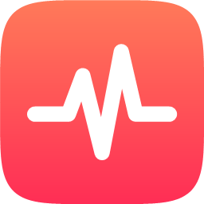
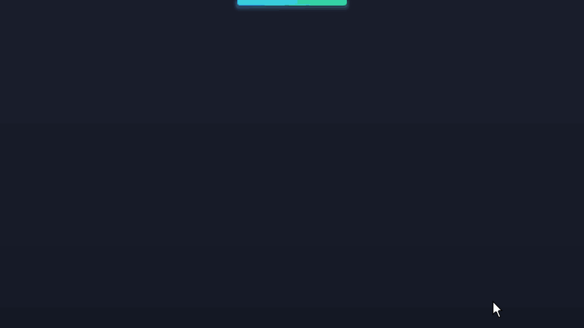
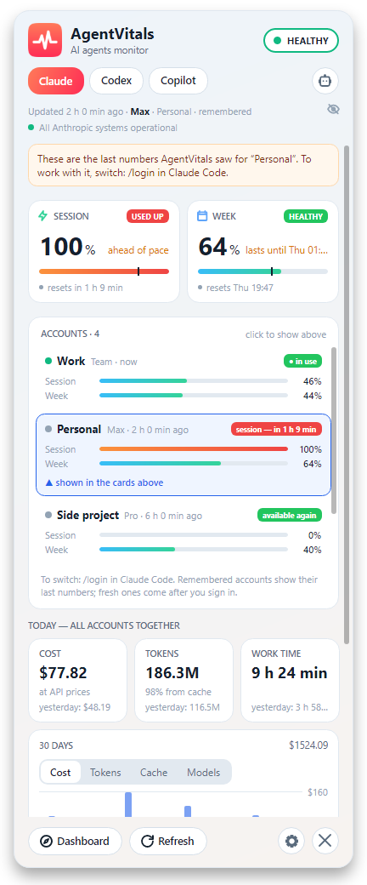
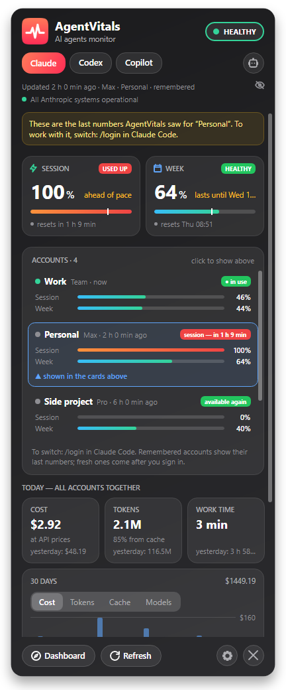
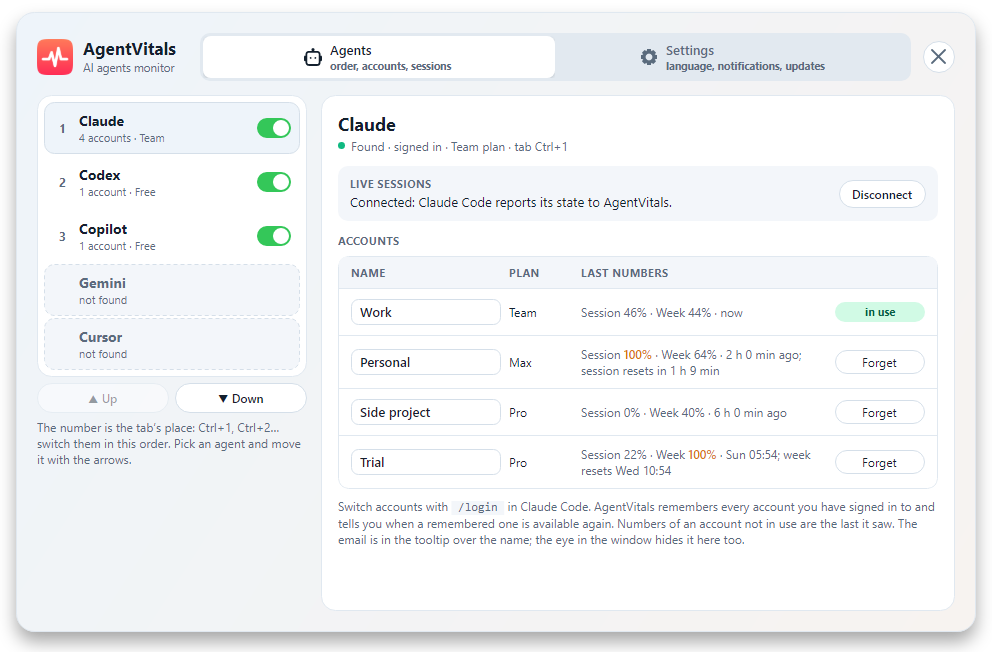
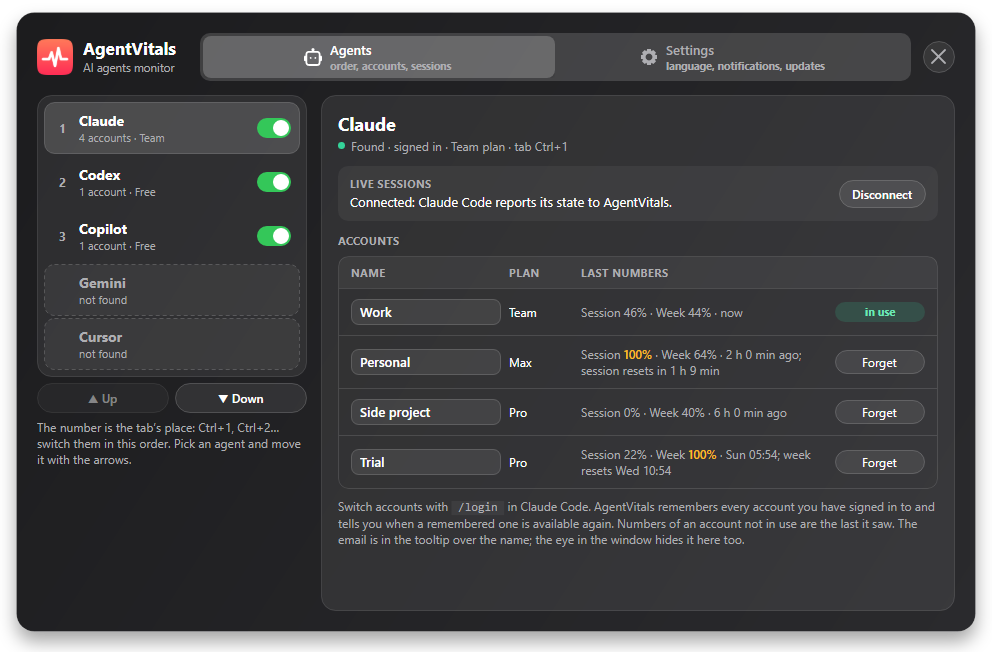
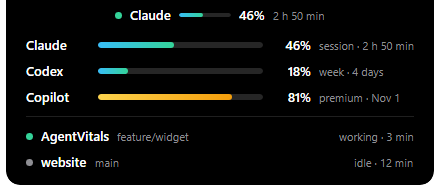
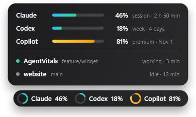
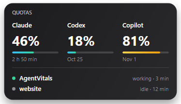

#  AgentVitals

[English](README.md) · **Русский** · [Українська](README.uk.md)

**Квоты AI-агентов, живые сессии и расход — в трее Windows.**

Программа в трее Windows для Claude Code, Codex, GitHub Copilot и Cursor. Она показывает, сколько
осталось от квоты каждого агента и когда она сбросится, что прямо сейчас делает каждая сессия
Claude Code или Codex, сколько сегодняшняя работа стоила бы по ценам API и работает ли сервис агента.
Уведомление предупредит, пока квота не кончилась, когда агент закончит долгий ход и когда он попросит
разрешения. У каждого агента, в который вы вошли, своя вкладка. Сделано по мотивам
[ClaudeBar](https://github.com/tddworks/ClaudeBar) и
[claude-status-bar](https://github.com/m1ckc3s/claude-status-bar) — они делают то же на macOS.

| Светлая тема | Тёмная тема |
|---|---|
|  |  |

Снимки — с английским интерфейсом; в программе он также на русском и украинском.

## Быстрый старт

1. Скачайте `AgentVitals.exe` из [последнего релиза](https://github.com/CrossWander/AgentVitals/releases/latest).
   Нужен [.NET 10 Runtime](https://dotnet.microsoft.com/download/dotnet/10.0). Установщика нет:
   exe запускается из любой папки.
2. Запустите его. В трее появится значок с пульсом. Windows 10 может спрятать его в скрытую
   область — один раз перетащите его на панель задач.
3. Каждый агент, в который вы вошли, сразу показывает свои квоты, на своей вкладке — см.
   [Агенты](#агенты). Чтобы видеть живые сессии, откройте [вкладку «Агенты»](#вкладка-агенты), выберите
   Claude или Codex и нажмите **Подключить** в разделе *Живые сессии*.

Наведите мышь на значок — появится краткая карточка, щелчок открывает всё окно, правый щелчок —
меню. Окно остаётся открытым, пока вы работаете в других окнах: закрывается ✕, ещё одним щелчком по
значку или Esc. На маленьком экране оно не выходит за его край: заголовок и кнопки стоят на месте,
а середина прокручивается.

## Что умеет

| Что | Что вы получаете |
|---|---|
| Квоты | Все лимиты, о которых сообщает агент, с отсчётом до сброса: сессия, неделя и недели по моделям у Claude; сессия и неделя у Codex, а на Free — месяц; премиум-запросы, чат и подсказки за месяц у Copilot; месяц с долями Auto и API у Cursor. Метка на полосе показывает, где был бы расход при ровном темпе → [подробнее](#квоты-и-оповещения) |
| Значок в трее | Линия пульса цвета того лимита, что ближе всего к исчерпанию; она бьётся, пока агент работает, а синяя точка мигает, пока он ждёт вас |
| Оповещения | Уведомления на 75% и 90% лимита (настраивается от 50% до 95%), когда при таком темпе лимита не хватит до сброса, когда сбросился критичный лимит, когда закончился долгий ход, когда агент просит разрешения и когда меняется статус сервиса агента; два тихих звука, которые можно включить, — для разрешения и для «критично» |
| Живые сессии | Каждая открытая сессия Claude Code и Codex, на вкладке своего агента, с папкой, веткой git, состоянием и временем хода → [подробнее](#живые-сессии) |
| Виджет | Квоты и сессии на экране без наведения на значок в трее: плашка вверху, значок над треем или карточка на рабочем столе; щелчки проходят насквозь к окну под ним → [подробнее](#виджет) |
| Аккаунты | Каждый аккаунт, в который вы входили, остаётся на вкладке агента со своими последними цифрами, а уведомление скажет, когда запомненный снова доступен → [подробнее](#аккаунты) |
| Статистика расхода | Для Claude и Codex: стоимость, токены и время работы за сегодня рядом со вчерашними; график за 30 дней по стоимости, токенам, кэшу или моделям → [подробнее](#статистика-расхода) |
| Статус сервиса | На каждой вкладке — статус её агента: status.claude.com для Claude, группа Codex на status.openai.com для Codex (вся страница OpenAI — только если группа пропадёт), компонент Copilot на githubstatus.com для Copilot, status.cursor.com для Cursor; уведомление, когда статус меняется |
| После сна | Спрашивает снова сразу после пробуждения ПК; окно, чьё время сброса прошло, показывает 0%, а не старые цифры |
| Обновления | Проверяет GitHub при запуске и раз в день и один раз сообщает о новой версии; **Обновить** в настройках скачивает её, сверяет SHA-256 и заменяет exe на месте → [подробнее](#обновления) |
| Показ экрана | Глаз в конце строки тарифа прячет почту аккаунта и запросы сессий — в окне, в краткой карточке и в виджете |
| Языки и темы | Английский, украинский и русский; светлая, тёмная или как в Windows |
| Клавиатура | Esc закрывает окно, F5 или Ctrl+R обновляют, Ctrl+1, Ctrl+2… переключают вкладки агентов по порядку |

## Настройки

Кнопка с шестерёнкой внизу окна или *Настройки* в меню по правому щелчку открывают окно AgentVitals
на вкладке «Настройки». Она устроена как [вкладка «Агенты»](#вкладка-агенты): разделы слева, их строки
справа. В *Общих* — язык, оформление, как часто проверять квоты и *Проценты квот*: «Использовано»
или «Осталось», одинаково в окне, виджете, уведомлениях и порогах; в *Уведомлениях* — уровни «важно»
и «критично», уведомления о сессиях и их два звука; в *Виджете* — какой [виджет](#виджет) показывать
и как; в *Запуске и обновлениях* — запуск вместе с Windows и обновления; в разделе *О программе* —
автор, версия и ссылки. За какими агентами
следить, порядок вкладок, живые сессии и имена аккаунтов — на [вкладке «Агенты»](#вкладка-агенты).

| Светлая тема | Тёмная тема |
|---|---|
|  |  |

## Агенты

| Агент | Откуда данные | Состояние |
|---|---|---|
| Claude | `GET api.anthropic.com/api/oauth/usage` с токеном Claude Code из `~/.claude/.credentials.json` | работает |
| Codex | `GET chatgpt.com/backend-api/wham/usage` с `~/.codex/auth.json`; почта аккаунта — из его `id_token` | работает |
| Gemini | запросы квот `cloudcode-pa.googleapis.com` с `~/.gemini/oauth_creds.json` | не проверено |
| Copilot | `GET api.github.com/copilot_internal/user` со входом GitHub, который git хранит в «Диспетчере учётных данных» Windows (`git:https://github.com`) | работает |
| Cursor | `GET cursor.com/api/usage-summary` со входом, который Cursor хранит в своём `state.vscdb` (только чтение): план с долями Auto и API и расход сверх него — свой или командный пул | не проверено |

Агента без файла входа просто нет в окне. Copilot появляется только после того, как GitHub хоть раз
его подтвердил: Copilot Chat идёт вместе с VS Code, так что его папка сама по себе ничего не значит.

Если Claude Code хранит вход в «Диспетчере учётных данных» Windows, AgentVitals читает его и оттуда и
берёт тот из двух, что действует дольше (не проверено).

## Аккаунты

AgentVitals запоминает каждый аккаунт агента, в который вы входили, — пользователя Claude в
организации, аккаунт ChatGPT у Codex, логин GitHub у Copilot, пользователя Cursor. Когда сессия
кончилась и вы переключились через `/login`, прежний аккаунт остаётся на вкладке со своими последними
цифрами, и видно, когда он освободится.

| Светлая тема | Тёмная тема |
|---|---|
|  |  |

- **Аккаунт в работе** — тот, чей вход сейчас у агента. Только у него свежие цифры, только он красит
  значок в трее и шапку и только о нём уведомления о квотах. После `/login` AgentVitals видит новый
  аккаунт за секунды, помечает его «цифры обновляются…» и сразу спрашивает сервер; пауза после 429 —
  у каждого аккаунта своя, и прежний не задерживает новый.
- **Карточка «Аккаунты»** появляется под карточками квот, когда у агента два аккаунта и больше:
  аккаунт в работе первым, остальные в порядке появления, у каждого — тариф, возраст цифр и полоска
  на каждый лимит. Видны три, остальные прокручиваются внутри карточки.
- **Щелчок по аккаунту** показывает его в карточках сверху с пометкой, что это последние цифры,
  которые видел AgentVitals. При каждом открытии окна сверху снова аккаунт в работе.
- **Плашка** говорит «в работе», «сессия — через 1 ч 10 мин» или «неделя — с вт 09:00», пока лимит
  запомненного аккаунта израсходован (тот, что сбросится последним), «снова доступен» — когда с тех
  пор сбросились все, и «свободен» в остальных случаях. Уведомление скажет, когда запомненный аккаунт
  снова доступен; щелчок открывает его вкладку с ним сверху.
- **Имена.** Аккаунт называется почтой (у Copilot — логином GitHub); у двух аккаунтов с одной почтой
  добавляется тариф. Под глазом — своё имя из [вкладки «Агенты»](#вкладка-агенты), а без него
  «Аккаунт 1», «Аккаунт 2»; у единственного аккаунта без имени — только тариф.
- Статистика расхода и живые сессии общие на все аккаунты агента: в журналах агентов не сказано,
  каким аккаунтом шла работа.

AgentVitals сам аккаунты не переключает и токенов не хранит: он помнит только тариф, почту, проценты
и номер аккаунта из файлов самого агента.

## Вкладка «Агенты»

Круглая кнопка с роботом в конце строки вкладок или *Агенты…* в меню по правому щелчку открывают
окно AgentVitals на вкладке «Агенты». Это обычное окно — оно есть на панели задач, двигается и не
закрывается само; переключатель вверху меняет «Агенты» и «Настройки».

| Светлая тема | Тёмная тема |
|---|---|
|  |  |

- **Список** показывает агентов в порядке вкладок: номер — место вкладки, оно же Ctrl+N.
  **▲ Выше** и **▼ Ниже** двигают выбранного агента. Ненайденные агенты — внизу, серые.
- **Переключатель** выключает агента: его не спрашивают, у него нет вкладки, уведомлений и влияния на
  значок; hooks остаются на месте. Включили — всё вернулось сразу.
- **Справа** — подробности выбранного агента: состояние, [живые сессии](#живые-сессии) с кнопками
  **Подключить** и **Отключить** и его аккаунты — поле имени (почта — в подсказке, глаз её прячет),
  тариф, последние цифры и **Забыть** у запомненного.

## Квоты и оповещения

- **Карточки.** Каждое окно квоты — карточка с процентом расхода, полосой и временем до сброса.
  Окно на 100% пишет «исчерпано». Дополнительный расход показывается, если он включён: extra usage у
  Claude, расход сверх плана у Cursor. Карточки идут парами; на вкладке только с квотами — без
  статистики и сессий, как у Copilot и Cursor, — каждая карточка во всю ширину.
- **Темп.** На полосах сессии и недели (и недель по моделям) стоит метка — где был бы расход при
  ровном темпе, а карточка пишет «в норме» или «с запасом» (в пределах 5 пунктов — в норме). Если
  расход опережает темп, карточка пишет, когда окно кончится, если продолжать так же: «хватит до
  15:40» или «хватит до чт 14:00» для недели. Подсказка над карточкой объясняет метку обоими числами.
- **Цвета.** Линия пульса в трее берёт цвет окна, которое ограничивает сильнее всего: зелёный ниже
  уровня «важно», жёлтый с него, красный с «критично», серый, когда данных нет. Это те же уровни, что
  у уведомлений, так что краснеет то, о чём предупреждали; карточки, полосы и заголовок следуют им
  же. Заголовок окна говорит за открытую вкладку, а вкладка, чей агент на исходе, получает точку
  этого цвета. Исчерпанная неделя красит значок в красный и при пустой сессии.
- **Уведомления.** Когда окно доходит до 75% («важно», осталась четверть) и 90% («критично», почти
  исчерпано), со временем до сброса. Оба уровня меняются в настройках шагом 5 от 50% до 95%. Каждое
  уведомление приходит один раз и снова — только после сброса этого окна; окно, которое уже за
  уровнем при запуске AgentVitals, тоже получает уведомление. Уведомление ещё пишет, до какого
  времени хватит остатка при таком темпе, если это раньше сброса. Доли Auto и API у Cursor — части
  его месяца, своих уведомлений у них нет.
- **Звук для «критично».** *Звук, когда квота почти исчерпана* добавляет тихий деревянный стук,
  две ноты вниз, только к уведомлению «критично» — по умолчанию выключен. Он не похож на восходящий
  звон запроса разрешения, так что их можно различить, не глядя.
- **Ранние уведомления и уведомления о сбросе.** С половины расхода и ниже «важно» — одно уведомление
  на окно, если при таком темпе его не хватит до сброса («Не хватит до сброса»). После уведомления
  «критично» — ещё одно, когда окно сбросится («Снова доступно»), в пределах минуты от времени
  сброса, не дожидаясь следующей проверки.
- **Как выглядит уведомление.** Оно выезжает в правом нижнем углу над часами и держится десять
  секунд для квоты или сессии и четыре для статуса сервиса — и всё время, пока на нём мышь;
  бледный ✕ в углу закрывает его сразу. Оно появляется поверх окна AgentVitals, если то открыто.
  Щелчок по уведомлению о сессии поднимает окно, в котором идёт сессия, а по любому другому —
  открывает окно AgentVitals. Каждое уведомление пишется и в `log.txt`.

Квоты проверяются по умолчанию каждые 5 минут (1, 2 или 10 минут в настройках; чем чаще, тем раньше
сервер ответит 429). После 429 AgentVitals ждёт столько, сколько сказал `Retry-After`, а если отказы
идут подряд — дольше: 5, 10, 20, затем 30 минут. После ночного сна токен Claude Code обычно истёк:
карточка держит последние цифры и ждёт, кроме окна, чьё время сброса прошло, — оно показывает 0% и
«сброшено» (расход с других устройств с тех пор не виден, пока не придут свежие данные). Claude Code
обновляет вход при первом запросе, а AgentVitals замечает новый файл и сразу спрашивает.

Последний ответ хранится в `quota.json`, так что после перезапуска карточка сразу показывает его с
возрастом («Обновлено 3 ч 10 мин назад» или «Обновлено пт 18:40» после выходных). Сервер спрашивают
снова, только когда с этого ответа прошёл интервал, и не раньше времени, которое он назвал в
последнем 429: перезапуск AgentVitals больше не тратит лимит запросов и не получает отказ сразу.

## Живые сессии

Вкладка «Агенты» → Claude → *Живые сессии* → **Подключить** добавляет hooks AgentVitals в
`~/.claude/settings.json`.
Каждый hook запускает в фоне `AgentVitals.exe hook`, который пишет по маленькому файлу состояния на
сессию в `sessions\` рядом с exe. **Отключить** убирает только записи AgentVitals.

- Пульс бьётся, пока агент работает, а синяя точка мигает, пока он ждёт вашего разрешения.
- У идущего хода видно, сколько он длится («работает · 3 мин»). Уведомление скажет, когда агент
  закончит ход дольше 5 минут или попросит разрешения; оба настраиваются или выключаются в
  настройках. *Звук, когда агент ждёт разрешения* добавляет тихий звон из двух нот только к
  уведомлению о разрешении — по умолчанию выключен и молчит, пока окно сессии активно.
- Список держит одну высоту — примерно четыре сессии — и дальше прокручивается, с тонкой полосой.
- Две сессии в одной папке показывают начало первого запроса вместо ветки, чтобы их различать;
  подсказка над строкой показывает папку, ветку и запрос целиком. Глаз рядом со строкой тарифа
  прячет запросы вместе с почтой.
- Щелчок по сессии там или по её уведомлению поднимает окно, где идёт сессия, — терминал, VS Code
  или другую IDE, — чтобы ответить сразу. AgentVitals ищет его от процесса агента вверх по
  родителям; когда у одной программы несколько окон, как у VS Code, выигрывает то, в заголовке
  которого папка сессии. Поднимается окно, а не вкладка: если вкладок несколько, нужную выберите
  сами. Если окно не нашлось, щелчок по уведомлению открывает окно AgentVitals.
- Ход, остановленный Esc, не вызывает hook. Об этом говорит журнал сессии, и сессия сразу
  переходит в простой, а не через 15 минут.
- Терминал, закрытый без `/exit`, тоже не вызывает hook. Hook запоминает процесс Claude Code, и
  сессия уходит из списка, как только этого процесса нет.
- Claude Code читает hooks при запуске сессии: сессии, открытые раньше, появятся после их
  перезапуска.
- AgentVitals переписывает `settings.json` обычным JSON, поэтому комментарии в нём не сохраняются.
  Перед каждым изменением файл копируется в `settings.json.agentvitals.bak` вместе с комментариями.
- Если перенести exe, вкладка «Агенты» об этом скажет — подключите заново. Перед удалением exe нажмите
  **Отключить**: иначе Claude Code продолжит вызывать программу, которой уже нет.
- **Codex.** **Подключить** у Codex пишет `~/.codex/hooks.json` (или `hooks.json` в
  `$CODEX_HOME`); каждый hook запускает `"AgentVitals.exe" hook codex`. Новый или изменённый hook
  Codex запускает только после подтверждения: откройте `/hooks` в Codex один раз после
  подключения и ещё раз после переноса exe. Esc в Codex вызывает его собственный hook `Interrupt`,
  так что сессия сразу переходит в простой. Сессии Codex видны на вкладке Codex, сессии Claude Code —
  на вкладке Claude.

## Виджет

*Настройки → Виджет* держат квоты и сессии на экране — не нужно наводить мышь на значок в трее.
Видов три, включён один; пока вы его не выберете, виджета нет.

| Плашка | Значок | Рабочий стол |
|---|---|---|
|  |  |  |

- **Плашка вверху** — чёрная форма по центру верхнего края экрана с треем. В покое это тонкая полоска
  цвета квоты, и вкладки браузера под ней остаются доступны. Задержите на ней мышь — выедет плашка:
  агент, процент и время до сброса. *В покое → Плашка* держит плашку на виду всегда, а щелчки сквозь
  неё всё так же проходят.
- **Значок над треем** — в углу рядом с треем: кольцо и процент каждого агента или один агент со
  временем до сброса.
- **На рабочем столе** — карточка под всеми окнами: колонка на каждого агента и до трёх сессий. Она
  остаётся после Win+D; перетащите её куда угодно — место запомнится. Щелчок по агенту открывает его
  вкладку, щелчок по сессии поднимает её терминал.
- **Щелчки проходят насквозь.** Плашка и значок ловят мышь, только когда она задержалась над ними на
  0,3 с: быстрый щелчок по вкладке браузера под полоской доходит до вкладки. Дальше щелчок открывает
  панель со всеми агентами и до трёх сессий, повторный — закрывает. В панели щелчок по агенту
  открывает его вкладку, по сессии — поднимает её терминал.
- **Какой агент.** *Агент* выбирает, кого показывают плашка и значок, или *По очереди* — каждого
  агента с данными по 6 секунд; у значка есть ещё *Все сразу*. Агент, у которого квота стала
  критичной, чередуется с выбранным каждые 10 секунд.
- **Ждёт и закончил.** Когда сессия просит разрешения, плашка выезжает сама: *Claude ждёт разрешения*,
  проект и инструмент; щелчок по ней поднимает терминал этой сессии, чтобы ответить. После долгого
  хода она 5 секунд показывает *Claude закончил*. Значок ведёт себя так же.
- **Свечение.** Плашка и значок светятся только на события: синий пульс, пока сессия ждёт, одна
  зелёная вспышка, когда ход закончился, медленный красный пульс, пока квота показанного агента
  критична. *Свечение* выбирает ореол, пробегающий блик или окраску цветом либо выключает его.
- **Движение при работе.** Пока агент работает, от полоски вниз расходится мягкая рябь, точка
  в выехавшей плашке мигает маяком, а от кольца значка расходится круг. Двигается только тот агент,
  который работает. Выключается переключателем *Движение, пока агент работает*.
- **Глаз и полный экран.** При включённом глазе виджет не попадает на снимки и в демонстрацию экрана
  (Windows 10 2004 и новее) и не показывает имён проектов, веток и инструментов; почта и запросы в нём
  не видны никогда. Пока на этом экране идёт полноэкранное приложение, плашка и значок спрятаны, даже
  если сессия ждёт.

## Статистика расхода

Под лимитами вкладки Claude и Codex показывают цифры за сегодня и график за 30 дней. Для Claude они
берутся из собственных журналов Claude Code в `~/.claude/projects` (вместе с субагентами) и читаются
только на этом компьютере: AgentVitals берёт количество токенов из ответов модели и больше ничего не
хранит. Каждый ответ считается один раз — Claude Code пишет один и тот же ответ несколько раз, пока
он приходит.

- **Стоимость** — сколько эти токены стоили бы по прейскуранту API Anthropic, и на подписке тоже.
  Цены берутся с [официальной страницы цен](https://platform.claude.com/docs/en/about-claude/pricing)
  раз в день и хранятся в `prices.md` рядом с настройками, так что стоимость считается и без сети.
  Модель, которой на странице ещё нет, остаётся без цены, а не с догадкой. Fast mode считается по
  обычным ценам.
- **Время работы** складывает отрезки активности; пауза дольше 30 минут начинает новый.
- **График** показывает стоимость, токены (вход и выход), кэш (запись и чтение) или стоимость по
  семействам моделей (Opus, Sonnet, Haiku, Fable; Astra, Sol, Luna у Codex; другие) — только те
  семейства, что были в эти 30 дней. В режиме кэша в углу написано, сколько кэш сэкономил за 30
  дней: сколько стоили бы закэшированные токены как обычный вход минус сколько они стоили.
- **Codex** читает журналы своих сессий в `~/.codex/sessions` и `archived_sessions` (в
  `$CODEX_HOME`, если он задан): по записи на ответ модели с количеством токенов и модель хода.
  Стоимость — по ценам Standard со [страницы цен OpenAI](https://developers.openai.com/api/docs/pricing),
  они хранятся в `prices-openai.md`; модель без цены закэшированного входа или записи в кэш платит
  за эти токены как за обычный вход.
- У Gemini, Copilot и Cursor статистики пока нет: место для неё есть (`IAgent.Usage`), читателя нет.

## Обновления

При включённом *Проверять обновления ежедневно* (по умолчанию) AgentVitals спрашивает у GitHub
последний релиз при запуске и затем раз в день и один раз сообщает о новой версии. Настройки →
*Запуск и обновления* → **Проверить** спрашивает сразу. **Обновить** скачивает `AgentVitals.exe` из
релиза, сверяет его SHA-256 с тем, что публикует GitHub, и отказывается от несовпавшего файла.
Затем короткий скрипт ждёт, пока программа закроется, кладёт новый exe на место старого — по тому
же пути, так что hooks продолжают работать, — и запускает его; если замена не завершилась за 40
секунд, снова запускается старая версия. После перезапуска уведомление называет запущенную версию и
открывает её описание. Предварительные релизы и черновики не предлагаются. Если exe лежит там, где
нельзя писать (например, в `Program Files`), карточка говорит об этом и ведёт на страницу релиза.

## Приватность

- **Входы только читаются.** AgentVitals никогда не обновляет токен: Claude Code и Codex делают это
  сами, а refresh-токен, потраченный кем-то другим, разлогинил бы агента. «Диспетчер учётных
  данных» и `state.vscdb` Cursor открываются только на чтение.
- **Токен GitHub остаётся у git.** Для Copilot AgentVitals читает вход, который git уже хранит в
  «Диспетчере учётных данных» Windows, заново перед каждой проверкой и отправляет его только на один
  адрес: `api.github.com/copilot_internal/user`. Он никогда не записывается, не попадает в журнал и
  не показывается, а в «Диспетчер учётных данных» ничего не пишется.
- **Вход Cursor остаётся у Cursor.** Он читается из `state.vscdb` Cursor перед каждой проверкой и
  уходит как cookie только на `cursor.com/api/usage-summary`: переадресации не выполняются, а
  cookie, которые ставит Cursor, не сохраняются.
- **Токены моделей не тратятся.** Запросы квот — не вызовы модели, так что проверка ничего не
  отнимает от ваших лимитов.
- **Куда подключается:** адреса квот из раздела [Агенты](#агенты), status.claude.com,
  status.openai.com, www.githubstatus.com и status.cursor.com, страницы цен Anthropic и OpenAI раз в
  день и GitHub: `api.github.com` для проверки релизов (её можно выключить) и скачивание релиза —
  только когда вы нажали **Обновить**. Больше никуда — ни своего аккаунта, ни телеметрии.
- **Последний ответ остаётся на этом компьютере.** `quota.json` хранит тариф, почту аккаунта и
  проценты последней проверки; токены не записываются никуда.
- **Журналы остаются на этом компьютере.** Статистика хранит только количество токенов. Чтобы
  заметить ход, остановленный Esc, конец журнала живой сессии проверяется на метку прерывания
  Claude Code. Ничего из журналов не покидает компьютер.

## Файлы

Всё лежит рядом с exe: `config.json` (настройки), `quota.json` (последний ответ о квотах), `log.txt`
(ошибки и изменения за два дня), `sessions\` (состояния сессий), `prices.md` и `prices-openai.md`
(цены Anthropic и OpenAI). Если папка только для чтения (например, в `Program Files`), они уходят в
`%LOCALAPPDATA%\AgentVitals`. Запуск вместе с Windows — значение в
`HKCU\Software\Microsoft\Windows\CurrentVersion\Run`. Обновление оставляет `AgentVitals.exe.new`
рядом с exe и `agentvitals-update-<pid>.cmd` в `%TEMP%` только на время своей работы.

## Сборка

Нужен .NET 10 SDK.

    dotnet test AgentVitals.slnx
    powershell -File tools\publish.ps1            # release\AgentVitals.exe, нужен .NET 10 Runtime
    powershell -File tools\publish.ps1 -SelfContained
    powershell -File tools\make-icons.ps1         # перерисовать src\AgentVitals\app.ico и app.png

Код — четыре проекта в `src\`, и каждый знает только тех, что перед ним:

- `AgentVitals.Platform` — вызовы Windows, файлы, журнал и звуки;
- `AgentVitals.Core` — квоты, расход, статус-страницы и живые сессии: модель и контракт, который
  заполняет каждый агент, без интерфейса;
- `AgentVitals.Agents` — по папке на агента с тем, что свойственно только ему: квоты, журнал расхода
  и страница цен, статус-страница, hooks и журнал сессии;
- `AgentVitals` — программа в трее: окна, строки, опрос, настройки и обновления.

`release\` — папка сборки, в git она не входит. Публикация релиза на GitHub запускает
[`release.yml`](.github/workflows/release.yml): он прогоняет тесты на исходниках тега, собирает exe
через `tools\publish.ps1` и прикладывает его к этому релизу.

README — на трёх языках: оригинал — `README.md` (английский), `README.ru.md` и `README.uk.md`
переведены с него. Правка одного идёт во все три.

## Лицензия

Apache License 2.0 — см. [LICENSE](LICENSE) и [NOTICE](NOTICE).

Copyright 2026 Dykalo Pavlo. Форки и производные работы должны сохранять содержимое `NOTICE` и
отмечать изменённые файлы (разделы 4b и 4d лицензии).

Claude и Anthropic — товарные знаки Anthropic PBC. Проект независимый, не связан с Anthropic, OpenAI,
Google, GitHub или Anysphere (Cursor) и не поддерживается ими; названия лишь указывают, какие
сервисы читает программа.

## Автор

Разработал Dykalo Pavlo, 2026.
